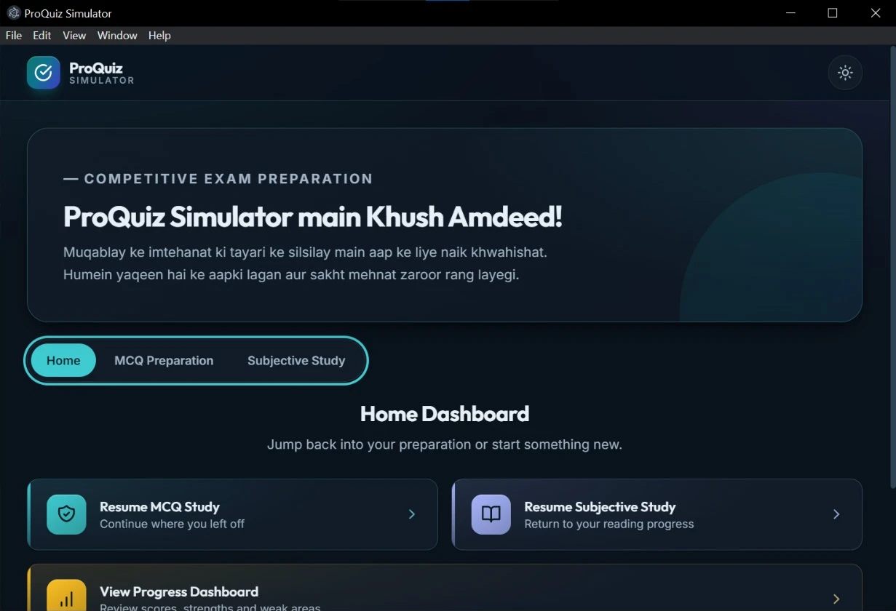
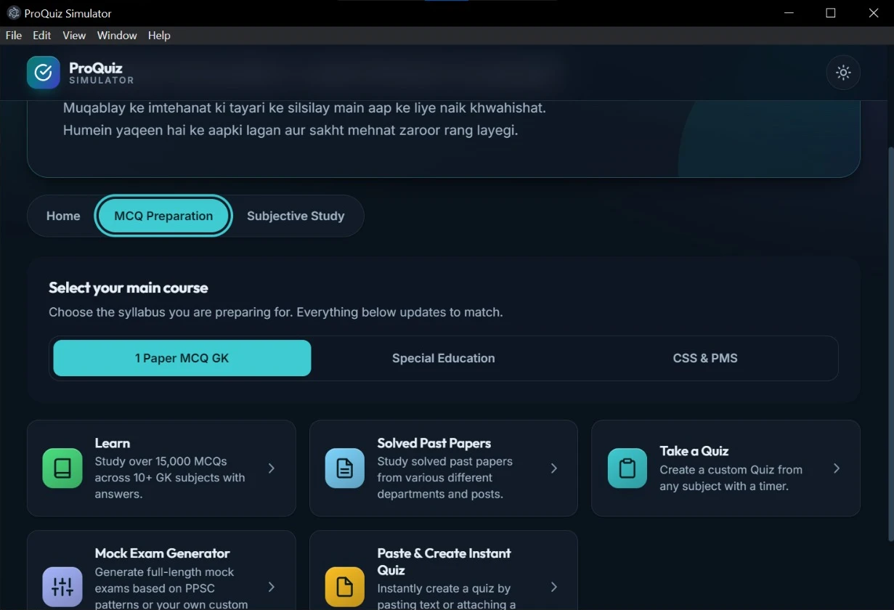
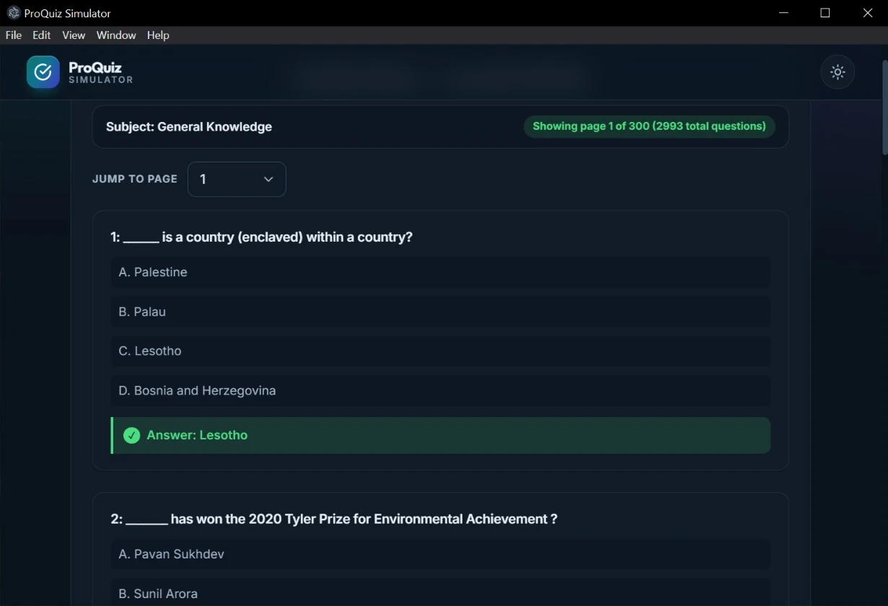
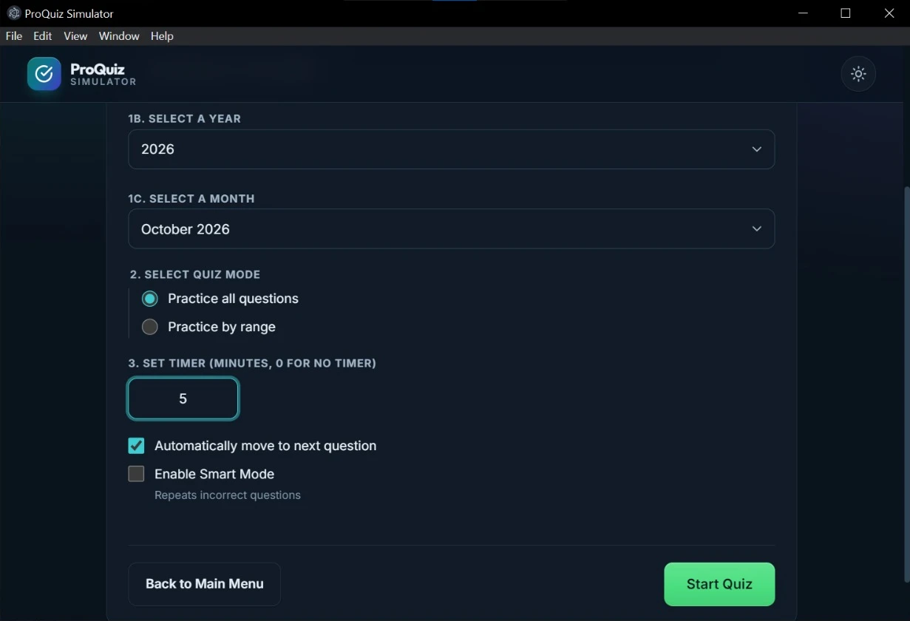
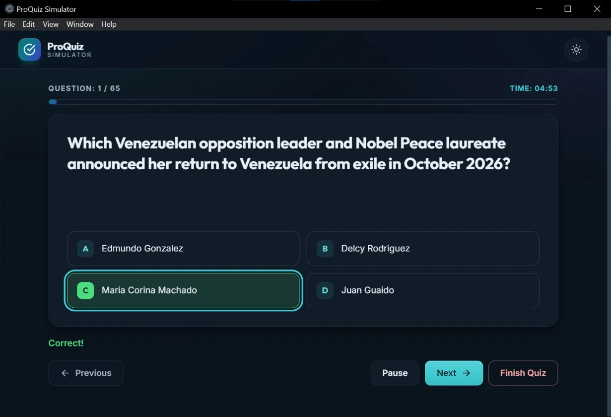
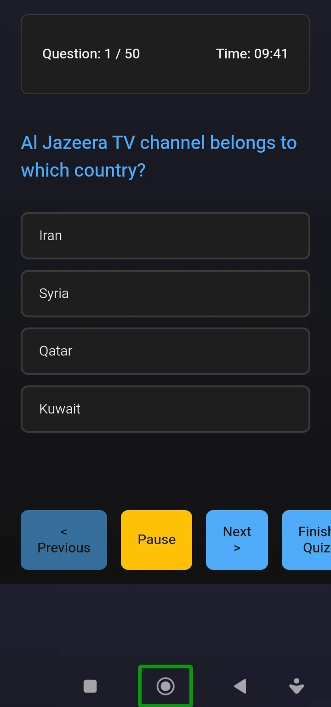

<p align="center">
  
</p>

<h1 align="center">ProQuiz Simulator</h1>

<p align="center">
  A Windows desktop study companion for competitive exam preparation — practice MCQs, take timed quizzes,
  generate mock papers, and study detailed subjective notes, all offline.
</p>

<p align="center">
  <a href="https://github.com/KhanHassanRiaz/ProQuiz_Simulator/releases/latest"><strong>Download the latest release</strong></a>
  &nbsp;·&nbsp;
  <a href="docs/USER_GUIDE.md">User guide</a>
  &nbsp;·&nbsp;
  <a href="docs/ARCHITECTURE.md">Architecture</a>
  &nbsp;·&nbsp;
  <a href="docs/BUILD_AND_RELEASE.md">Build &amp; release</a>
  &nbsp;·&nbsp;
  <a href="samples/README.md">Code samples</a>
</p>

<p align="center">
  
  
  
  
</p>

---

## Overview

ProQuiz Simulator is an offline-first Electron application built for students preparing for
competitive exams. It combines question-bank practice, exam-style mock papers, and long-form
subjective study material in a single desktop app with a fast, distraction-free interface.

The application source is proprietary. This public repository hosts the **official release
downloads**, product documentation, and a small set of **sanitized code samples** that show how
the app is engineered.

## Features

| Area | Highlights |
| --- | --- |
| **Learn mode** | Read question banks with answers visible, study all questions or a specific range. |
| **Quiz mode** | Timed practice with configurable duration and optional "repeat wrong answers" smart mode. |
| **Instant quiz** | Paste your own MCQ list and start a temporary quiz immediately — no import step. |
| **Mock exam generator** | Generate full-length, exam-style papers with default PPSC-style distribution or a custom subject mix. |
| **Subjective study** | Structured notes and courses with topic selection, page ranges, and Roman Urdu support. |
| **Bookmarks** | Save your position in both MCQ and subjective study modes. |
| **Themes** | Light and dark themes. |
| **Offline-first** | Content packs are bundled locally; studying does not depend on a network connection. |
| **Auto-updates** | Release metadata (`latest.yml` + blockmap) lets installed apps verify and update to new versions. |

## Download

Grab the latest Windows installer from the **Releases** page:

> **[Download ProQuiz Simulator](https://github.com/KhanHassanRiaz/ProQuiz_Simulator/releases/latest)**

Each release publishes:

- `ProQuiz-Simulator-Setup-<version>.exe` — Windows x64 installer
- `ProQuiz-Simulator-Setup-<version>.exe.blockmap` — differential update support
- `latest.yml` — update metadata consumed by the installed app

## Screenshots

| Home dashboard | MCQ preparation hub |
| --- | --- |
|  |  |
| Resume your last session and see your overall progress. | Pick a course, then choose Learn, Quiz, Instant Quiz, or Mock Exam. |

| Learn mode | Quiz setup |
| --- | --- |
|  |  |
| Read question banks with the correct answer always visible. | Choose a month, question range, timer, and smart mode. |

| Quiz in progress | Mobile quiz view |
| --- | --- |
|  |  |
| Timed practice with instant feedback and pause/resume. | The same question bank on the Android companion app. |

<sub>Captured from ProQuiz Simulator v3.7.11 on Windows 11. More images live in [`assets/screenshots/`](assets/screenshots/).</sub>

## Tech stack

- **Runtime:** Electron, Node.js
- **Interface:** HTML, CSS, vanilla JavaScript, Tailwind CSS
- **Data:** locally bundled content packs with a content-addressed cache
- **Updates:** `electron-updater` + GitHub Releases
- **Packaging:** `electron-builder` (NSIS, x64)
- **Release safety:** build staging + JavaScript obfuscation for the distributed bundle
- **Services:** Firebase (authentication), with configuration kept out of this public repository

## How it is built

The release pipeline focuses on two things: **not shipping unnecessary version bumps** and
**making releases safely repeatable**.

1. The Tailwind stylesheet is rebuilt.
2. A SHA-256 hash is computed over every packaged source file.
3. The version is bumped **only if that hash changed** since the last release.
4. The app is copied to a staging directory, obfuscated, and packaged with `electron-builder`.
5. A release script creates the GitHub release, or **updates the existing one in place** by
   replacing `Setup.exe`, the blockmap, and `latest.yml`.

See [docs/BUILD_AND_RELEASE.md](docs/BUILD_AND_RELEASE.md) for the full workflow.

## Repository layout

```
.
├── assets/                 Banner, screenshots and other public media
├── docs/
│   ├── ARCHITECTURE.md     How the app is structured
│   ├── BUILD_AND_RELEASE.md  Versioning and release automation
│   ├── USER_GUIDE.md       Feature guide (English)
│   └── USER_GUIDE_UR.md    Feature guide (Roman Urdu)
├── samples/                Sanitized, illustrative code samples
├── SECURITY.md
└── LICENSE
```

## License

The ProQuiz Simulator application and its source code are proprietary and
**All Rights Reserved**. This repository contains public documentation and illustrative
samples only. See [LICENSE](LICENSE).

## Contact

Maintained by [Khan Hassan Riaz](https://github.com/KhanHassanRiaz).
For bugs and feature requests, please use the repository's issue tracker.
For security reports, see [SECURITY.md](SECURITY.md).
